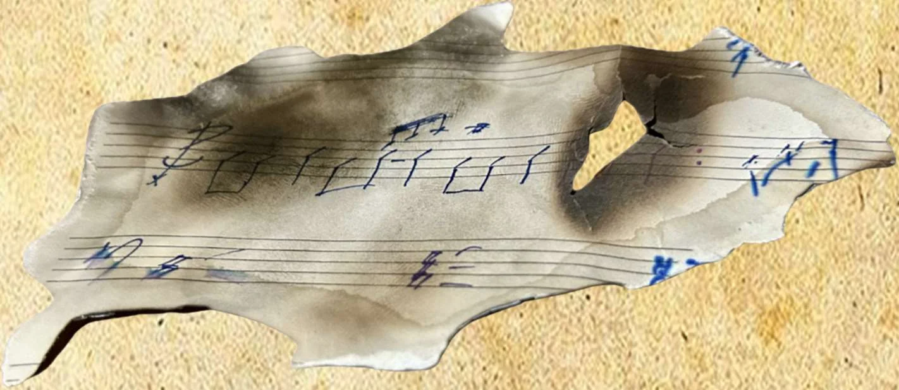

# An Analysis of the Regional Musics of Temuair and Medenia

_by Inuyoko in **Dark Ages**_

For the consideration of the Mileth College:

Before I begin this analysis in earnest, I feel it is helpful to define some terms on this first page, as they may not be universally understood. This is to be considered a supplement to the primary dissertation. To my knowledge, only one Aisling prior has been formally recognized by the College for the subject of Music and its components (distinct from the submission of music itself). This work is Kandolo's [Theory of Temuairian Music](Kandolo-Theory-of-Temuairan-Music.md) and its relation to Elemental Magic. In it, Kandolo briefly describes some terms which form the basis for our understanding of musical construction, namely that of chromatic steps and other intervals. All pitched sound is created by vibrations, whether it be of a string on a harp or a lute, or the echoing whine of a sword that has been struck by another metal. When these vibrations occur at exactly half or twice the speed of another vibration, we call this pitch relationship (interval) an 'octave'. Indeed, one may recognize this term as the very same which describes the gods of our realm, and their relationship to one another, and that is no accident. However, it has been my experience that the interval of the octave is most commonly split into twelve relatively equal parts. This has to do with the nature of ratios and other such things which we do not need to get into at this moment, but these twelve steps are what Kandolo was referring to when he spoke of chromatic steps. The number of chromatic steps between any note and another note is an interval, and is named based on how many of those steps are taken.

A quick reference of terms:

- Chromatic steps: Referring to the 12 notes which divide an octave.
- Octave: The difference in pitch between two vibrations that are twice as fast, or half as slow as the other. Or, the interval between any pitch and one 12 chromatic steps higher or lower.
- Minor third: The interval between any pitch and one three chromatic steps higher or lower.
- Major third: The interval between any pitch and one four chromatic steps higher or lower.
- Minor/Major Second/Sixth/Seventh: The interval between any pitch and one 1, 2, 8, 9, 10, or 11 chromatic steps higher or lower respectively.
- Key: The tendency of a section of a music to stay within a certain number of specific pitches, and to gravitate towards a specific 'home' pitch. In other words, the 'key of B Minor" refers to music gravitating towards the pitch we call 'B', and using minor variations of the third, sixth, and seventh intervals. The 'key of C Major' refers to music gravitating towards the pitch we call 'C', and using major variations of those intervals.
- Diatonic: Only utilizing the notes of the key one is playing in.

Now then, to truly begin...

## Part one: The Musics of Temuair

I come from a family of quite musically gifted Aislings. I would like to say that I hold the same gifts as them, but alas I feel my Spark has drawn me to other pursuits. However, I have grown up with a deep appreciation for music, and hope myself to become a Bard one day...

I have spent many suns within the Shrine of Deoch, reflecting in silence. Taking silent walks along the rivers of Suomi and admiring the majesty of nearby Porte Forest. Only, was it truly all in silence? No, for breaking the silence was the calls of the birds and other creatures. The rustling of leaves amongst whistling gusts of wind. The creaking of wood from the many buildings withstanding the trials of time in the village...And there was also music.

I'm sure you've heard it. They are rarely seen, but there is a musical culture to each part of our world, and Mundanes and Aislings who preserve it. In Suomi, there is a tune which can be heard often. If you aren't close, it may seem as though there is a pricking in the back of your mind. A ticking, almost like you feel the passage of time physically...but no, it is the soft plucking of stringed lutes. Eventually, it is joined by lush bowings, and then by flutes and other wind-powered instruments.

This got me to thinking: Why this song specifically? I rarely hear it when I walk through the streets of Mileth, instead replaced by a different tune. Strings and winds can still be heard, sure, but there's an entirely different feature to the music in the mainland: Bells.

My first point of argument here is in service of answering the question: What defines the character of each region's music? It stands to reason that bells are an important symbol in a world standing in the shadow of the great age of Hy-Brasyl. Metal is a fantastic conductor of sound, and even in its crafting would one notice the differences in the pitches which ring out when different forms of metal are struck.

It is my belief that bells are integral to the character of Temuairian music. They toll atop each of our churches, and smaller ones can be seen amongst the knick-knacks of many Mundanes throughout the land. For those who are experienced enough to have travelled to Medenia, one may notice a decidedly different character to the type of music that is performed there. More on that later.

Suomi and Undine are exceptions to this, perhaps because of their separation from the mainland by the sea and the mountains. This is not to say that performers do not use bells in these towns, but Mileth, Rucession, and Abel all feature bells heavily in their local musical traditions, which suggests a shared historical significance.

There is another feature that is widely shared amongst the traditional music of Temuair, that of its key. As I travelled to each region and spoke to Mundanes about their local music, I was given performances, and shown aged pieces of sheet music, which illuminated something to me. This music is overwhelmingly in Minor keys! Now, I don't necessarily agree with Kandolo in his sweeping description of Minor intervals as being 'evil' and major ones as being 'good', but there is a decidedly different characteristic to music that utilizes each. I personally found the musics of Temuair to be often reflective, sometimes brooding or perhaps somber. But ultimately, the word I landed on was settled.

Temuair is the land that we Aislings have been settled in for the longest, only breaking the seal to Medenia within some of our lifetimes, firmly in the era of Deoch. So the music of villages like Mileth, Rucession, and Suomi, carry a somber and settled tone to them. Interestingly enough, they all seem to gravitate towards similar pitches as well. In Rucession and Abel, musicians often prefer A minor. In Mileth, G# minor. In Suomi, B Minor. In the instances where the folk songs of Temuair went into Major key territory, such as in one of the songs of Rucession, it was usually in the relative Major key! That is to say, the Major key which shares the same pitches as its Minor but gravitating towards a different resting place. All of these keys are within a Minor third of each other, which could be coincidence, or could have larger meaning, but I do not have this answer.

But among the regions of Temuair, there are two places where the folk music breaks some of the typical conventions: Abel, and Loures Harbor. I believe the reason for this is their location and function. They are both harbor towns, connections between other places, and so their music appears to reflect a sort of mix of musical culture, but in two unique ways.

First, I spent some time in Abel, speaking to Mundanes to try to glean some more insight into this. I spoke to Frida the Tavernkeep, for I knew that taverns are often magnets for the performing type. I was not disappointed. During our discussion, Frida told me about raucous nights of old wherein the sailors drank and sang shanties while visitors from Undine and Suomi played bells and strings alongside folks from the mainland. They played off of one another and found ways to meld their different styles of play into new and exciting harmonies and melodies. Recall that I mentioned the predominant folk songs in Suomi being in B minor, and in Mileth G# minor. Between those is A minor, and it no accident that the songs that can often be heard emanating from the tavern on busy nights are in that key. There are couple of notes that are different between G# and B Minor, namely G and A natural. I was curious at first what the significance was when Frida told me this. But then, with a grin, she stepped away for a few moments, before returning with a tray, upon it a large set of handheld bells of various sizes! One by one along the line, she shook each bell and the pitch rose. Through the series of tintinnabular echoes, I heard a dissonance and a chromaticism in the middle that struck me as uniquely Abelian, though I could not quite put my finger on why.

She explained: One particularly irritable night, Aricin the Guild master was nursing one too many drinks, and demanded with two pounds of his fist upon the bar table, "We need something slower! Something softer! My head is killing me..." The atmosphere in the room muffled, and the air hung heavy for what must have felt like an eternity. And then, a young lutist started softly playing. A quiet ostinato which rocked back and forth, A to C, then A to B, and back and forth...The music had an almost trance-like quality. Two bell players, the former owners of the very bells I was being shown, started to add flourishes. Half-drunk sailors listened intently and then began to hum softly. Sustained notes pedaling beneath this strange soundscape. More joined in, and soon the energy began to build again, much to Aricin's chagrin at the time.

You may be wondering what the significance of this is. Well, much like choices are made as to what notes a lute or a harp are tuned to, so do bell players prefer certain sets. Those notes I mentioned that are not shared between G# Minor and B minor, they were all present in the combined sets of bells these folks were playing. This meant that the typically clear melodies and diatonicism one would hear in most folk songs was now being ignored. Or at least played with and stretched. Chromatically descending harmonies define the middle section of this song, at least in the contemporary version we are most likely to hear, and that is a unique product of Abel as a port town. As I bid farewell to Frida, she gave me one last parting gift: a small remnant of sheet music left by some musicians long ago, unfortunately almost entirely lost to fire.



I also mentioned Loures Harbor. I was fortunate to meet with a couple of Mundanes who were performing near the park where the statues of the seal breakers stand. One had a set of bells, one was blowing on a flute. I asked if they could play me something that represented the Harbor to them and tell me a bit about it. To my surprise, the song they played for me also had a surprising amount of chromaticism to it, and the young lady's skill with the bells was hard to deny. But it wasn't just that that made it stand out. No, this song was essentially entirely in C Major! It's not that no one ever plays music in Major keys in Temuair, that would be a silly assertion. But there was something surprising about the character of the music. It felt... whimsical, uplifting, and fresh. To hear it made me feel as though I had places to go, things to do; that adventure was just around the corner.

And this is likely because it sort of is. Much like Abel connects the villages separated by the sea and mountains, Loures Harbor connects the old land to the new. Perhaps Medenia is not so new to us anymore, but relatively speaking, it is. And the nature of this music in Loures Harbor would begin to make much more sense once I took my leave of Temuair and embarked towards Asilon.

## Part two: The Musics of Medenia

This section will be a bit shorter than the last, primarily because even after many Deochs, it is still difficult for most Aislings to travel the breadth of the Medenian continent. It is no different for me, a simple Priest who has not yet obtained her Grand Master armor, let alone ascended to Bardhood! But I have a few observations from my time there that I would like to share.

Firstly, my pre-conceived notions were shattered pretty quickly during my time there. I had pre-supposed that because the harp is the Bard's instrument of choice, that it would take a more dominant position in Medenian music, but I found that did not seem to be the case. Kandolo speaks in his work specifically about the relationship between music and magic, and I certainly don't have many disagreements with him there. It seems that this connection is much more important in the Bard's consideration than musical performance. No, what I found instead was a heavy emphasis on percussion instruments. Not only drums, but all manners of objects used to create a wide variety of sounds that, when combined, gave much of the music I heard a driving force to it. I stopped a group of troubadours in the Asilon Prairies and asked if I could join them and hear some of the songs of Medenia. We walked a great distance, passing through the Noam Plains and what I heard began to put my experiences in Loures Harbor into focus.

Nearly everything they played was in a Major key! C Major, Bb Major, A Major. They played a slow ballad, characterized by large, soaring arpeggios which made me feel wistful as I heard it. Even this piece I learned was in a Major key. I believe this is where my primary disagreement comes from with others who believe that Major and Minor keys have universal, inherent qualities. It is a wondrous display of creativity at which Deoch would beam, the way in which Medenian musicians have transformed their Major-key music to express sorrow and sobriety. But the overall character of Medenian music had a lot in common with what I heard in the Harbor. Upbeat and driving, it was exciting in a way that few things are outside of a dangerous hunt or quest.

One other thing that I found interesting was during my time in Hwarone. I was shown an interesting magical item known as a Bard's Note. This item was able to produce music from seemingly nothing (Kandolo's music-magic association grows stronger, it seems)! What's more, it produced some sounds that were different from those I was used to, and that I had never heard before! It would certainly be an interesting endeavor to research what potential magical items such as these could have in music composition.

I hope to be able to spend more time in Medenia, studying their musical culture, in the future. But for now, it was time for me to return home and reflect on everything I had learned.

## Part Three: Conclusion

There is something I mentioned in the foreword to this paper, about the relationship of the gods and music. This is yet another subject I wish to analyze in more detail, but in my discussions with various musicians, I did learn that the use of the term "Octave" in relation to the Gods and a musical interval is not a coincidence! I spoke a lot in this paper about keys, and one of the defining features about keys is that they almost universally have eight notes to them. A Minor has A-B-C-D-E-F-G and then A again. Bb Major has Bb-C-D-Eb-F-G-A and then Bb again, and so on. It seems that the theology of the Octave and our eight Gods influenced our music, just as it has so many other aspects of our world.

While creative expression and bending of tradition is not unheard of in Temuair, it appears in my estimation to be decidedly more conservative in its music in most cases than Medenia. Whether this is simply due to a cultural difference, or the increased influence of spirits of nature, I cannot say. If Kandolo's association between music and the elements is to be believed, then perhaps this elevation of elemental energy has some impact on the way Mundanes and Aislings express themselves through music. And perhaps it says something about the nature of Mundanehood and its relationship to Art, even lacking the Spark that we as Aislings have. That is a story for another day.

Remember: music is all around us,and if you stop to truly listen, there is much to be learned.

***

```
*Librarian Notes*

Recognized: Kingdom, 2025 (Mileth College master list).
This entry has been edited to conform to Library formatting.
The original can be found at https://novus-imperia.com/college/phi/inuyoko_musics.pdf .
```
