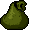
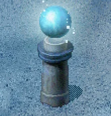
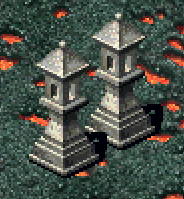

# Magic Charms

_by KelberKai in **Dark Ages**_

## Introduction

We've all partaken in magic charms at one point or another, if not daily. The slang is familiar to all—pop a double; eat a starfish. For most of our cherished history, they've been a cornerstone of aisling culture. Today, the strongest titans among us consider magic charms essential for hunting.

Our lorekeepers have done a great job compiling everything we need to know on how to use magic charms. But no philosopher has taken up the task of explaining what they are, fundamentally. Given that magic charms have been a staple in our society for generations and generations to come, a dispassionate analysis of their impact on culture is also warranted.

This essay investigates the properties, origins, interactions, and social relevance of magic charms. This first section provides a general overview of magic charms: their taxonomy, how they're consumed, and how they're procured. The body of the essay mostly canvasses the properties and origins of the magic charms and the interactions between them. The final section examines contemporary debate surrounding the limits on consumption and whether magic charms have a positive or ruinous effect on society.

I'm indebted to Vorlof `((https://www.vorlof.com/general.html))` for hosting a compendium on the lore of magic charms. The lore gives us the scaffolding to explore the philosophical dimensions of this subject matter. Some of this philosophical discussion can be classified under the subdomains of botany and alchemy.

## General Overview of Magic Charms

### Taxonomy

Magic charms can be divided into two broad groups based on the psychological effects that they have on the mind: psychedelic charms and stimulant charms.

Psychedelic charms induce an altered state of consciousness in which we absorb a massive rush of experience. Magic charm users describe it as if Gramail is taking us on a journey through time and space. Alchemists call the phenomenon 'Gramail's trip'. The entire episode lasts no more than five seconds, yet subjectively, it feels much longer. Our subjective sense of time is distorted while in the psychedelic trance.

The experience rush from psychedelic charms is usually a mix of both insight experience and ability experience, but some only give insight experience. Examples of psychedelic charms include the golden starfish, lucky clovers, and Andor Rock (the name of the charm found in Andor chests).

The second category of charms is stimulant charms. Informally, they're called 'bonuses' and 'doubles'. As the name implies, stimulant charms invigorate our minds. With our mental faculties enhanced by stimulants, our minds can process information obtained through sensory input more efficiently. This allows us to gain a higher rate of experience from the activities in which we engage.

Stimulant charms last much longer than psychedelic charms. Stimulants can last anywhere between two hours to eight hours `((fifteen minutes to an hour in terran time))`. Aislings like to save stimulant charms for hunting or when they know they're about to engage in an activity that yields significant experience.

Each stimulant charm enhances our capacity to process either insight experience, ability experience, or both. The factor by which an individual stimulant enhances our experience ranges from low to high `((as low as 5% to as high as 100%))`. Examples of stimulant charms include hy-brasyl shards `((XP/AP doubles))` and Luathas' spectacles.

`(( Formula for stimulant charm bonus ))`

`(( The equation for stimulant bonuses is the following:`

`Total insight experience/ability experience = Raw XP/AP x S1% x S2% x S3%...`

`Raw XP/AP = the experience/ability experience gained before the bonus is applied.`

`S[X]% = an active stimulant and by how much it multiplies the experience gained.`

`For example, take the case of a hunter who gains 150,000,000 million experience for completing the Mount Giragon Daily Quest with one active double stimulant and one active 50% stimulant:`

`150,000,000 x 2 x 1.5 = 450,000,000 total experience gained. ))`

### Method of consumption

How do you consume a charm? We don't ingest them. Charms possess magical properties that the user activates with their mind. Once a charm is activated, it dissolves into a cluster of floating, shimmering particles that we inhale and absorb through our skin. Psychedelic charms dissolve within seconds while stimulant charms hover around us like a magic glyph, slowly dissolving away for as long as two to eight hours `((15 minutes to 1 hour in terran time))`.

Psychedelic charms don't require willpower to activate. However, activating a stimulant charm requires us to cast a spell on ourselves, which costs a negligible amount of willpower `((1 MP))`. This makes sense because the duration of stimulant charms is long, and thus magic is needed to sustain the effects.

There's an exception to the method of consuming Luathas' spectacles. Luathas' spectacles provide visual stimulation. This mass item slowly dissolves like any other stimulant charm, but we don't inhale the charm or absorb it through our skin.

As countless aislings discovered without cracking open a lorebook, psychedelics and stimulants can be combined to exponentially increase the experience gained. When combined together, the experience gained from psychedelic charms is multiplied by a factor of the potency level of the stimulant(s).

### Procurement

There's three ways that magic charms are produced: they can be cultivated, created through alchemy/transmutation, and manifested into existence through divine actors. Between the three methods, alchemy is the most complicated process to explain.

While many charms grow naturally in the wild, Dar the dark wizard explained that many magic charms on the market are created through advanced alchemy. To create certain psychedelic charms through alchemy, alchemists must work with a base product that already contains modest amounts of active psychedelic properties. Alchemists perform transmutation on the base product to enhance the active properties, making the experience more potent for the user. Transmutation involves 'baking' the base product into a compressed block-like form that has a stronger concentration of the psychedelic properties. As detailed later in this essay, there's a few examples of psychedelic charms created through alchemy. One example is Andor ant wizards performing transmutation on Andor Rock (from Andor chests) to upgrade it to Royal Rock (found in the Andor Queen's chest).

Creating stimulant charms through alchemy is a little different because the base product contains latent stimulant properties that aren't active. Therefore, the base product isn't considered a magic charm yet because an aisling can't use it as a charm. This is different from psychedelic charms where the alchemist is actually empowering a charm to strengthen its potency. Take hy-brasyl shards as an example. As described later on in this essay, remnants of hy-brasyl contain latent stimulant properties that aislings can't activate on their own. You can't simply fetch a hy-brasyl fragment in Cthonic Remains and activate it. Alchemists must transmute the stimulant properties in finished hy-brasyl to create hy-brasyl shards.

Dar won't help aisling wizards conduct this advanced form of alchemy because the mundanes are very strict about who has permission. In Temuair, wizards must be sanctioned by Jean of Loures before they can perform this alchemy without legal repercussions. Aislings can only perform a limited form of alchemy through wizardry research to create smoke bombs.

Besides finding charms in the wilderness and creating them through alchemy, there's a third way charms are produced: divine will. As discussed in greater detail below, there's a couple stimulant charms that manifest through divine actors or spiritual beings. Luathas' spectacles are given out to worshipers at Luathas mass, and the elemental runes are blessed by the elemental spirits of Medenia.

However, some alchemists argue Luathas manifests the spectacles through divine alchemy using hy-brasyl, and therefore Luathas' spectacles are created through alchemy.

The next two sections form the body of this essay. They describe the properties and origins of each charm. First we start with psychedelic charms and then stimulant charms.

## Psychedelic Charms

There's a wide range of psychedelic charms on the market, far more than stimulant charms. These charms can be categorized in several ways. This essay groups them based on how aislings encounter them, rather than how they're created. This way of grouping them is more intuitive for readers.

The following list is broken down by charms found in: the wild, mundane event prizes, mundane daily quest prizes, dungeon treasure, and seasonal treasure.

### Wild Charms

Three psychedelic charms are found in the wilderness. Two golden starfish and clovers appear during events. The baem egg can always be found in Plamit Caves.

#### The Golden Starfish


Golden starfish appear naturally in Paradise at Lynith. Paradise is a mythical dream-like plane that aislings can visit in the tropical season. In all other seasons, there's a fog obscuring the oasis to Paradise.

The golden starfish is the same species as the red starfish that appear on the beaches of Paradise. The red starfish turn golden after absorbing a high concentration of psychedelic magic that permeates Paradise. Why do only some red starfish go through this transformation? According to wizards, some red starfish have a better capacity to absorb more of this psychedelic magic. The wizards claim that we inhale this same psychedelic magic in Paradise, making it appear like a tropical dream when in reality we travel to a few islands close to Lynith beach. Talk about a summer trip!

When an aisling absorbs all the psychedelic properties from the golden starfish, the starfish reverts back to its red state.

The amount of experience and ability that aislings gain from consuming the Golden Starfish is much higher the first time compared to every subsequent usage. This is because aislings become less sensitive to the psychedelic properties of the Golden Starfish. This desensitization effect only happens with golden starfish and clovers. The potency is moderate but always relative to the aisling's insight/ability experience potential. Aislngs must wait forty suns `((five terran days))` before consuming another golden starfish.

#### Clovers, Lucky and Normal


The clover is a mystical plant that sprouts across Temuair during the leprechaun season. Leprechaun season is when magus fortuna, also called luck magic, descends upon Temuair. Not much is known about why or how luck magic enchants our world. Are the Leprechauns responsible for this magic or does the magic itself bring out the leprechauns? We know that leprechauns and clovers appear more frequently in many towns during this season.

Botanists have confirmed that magus fortuna is the key fertilizer agent that enchants the clovers with psychedelic properties. This magic causes the clovers to grow much bigger in size. The clovers sprout into either normal clovers or lucky clovers. Normal clovers are the more abundant type and contain negligible amounts of psychedelic properties. Meanwhile, the lucky clovers are tougher to find but contain a significantly higher amount of magic psychedelic properties. The potency for lucky clovers is moderate but always relative to the aisling's insight/ability experience potential.

While the amount of experience that aislings gain from consuming the lucky clover remains constant each subsequent use, the ability experience gained decreases after the first use. This is because aislings become less sensitive to the psychedelic properties of the lucky clover but only in relation to ability. As stated earlier, this desensitization effect only happens with golden starfish and clovers.

Aislngs must wait forty suns `((five days terran days))` before consuming another lucky clover. There's no downtime for consuming normal clovers.

#### The Silver Baem Egg


The baem dragons in Plamit have naturally high levels of psychedelic magic. It flows through the blood of these majestic lords of the skies. Their silver eggs contain enough high concentrations of these psychedelic magic to be used as a charm. The baem dragon hatchlings feed off this psychedelic magic in their infancy. Sadly, this means aislings risk starving these hatchlings to death. Silver baem eggs are dangerous to hunt. They're highly sought after for quests and learning new abilities. Their rarity and high demand is why aislings don't rely on them as psychedelic charms. The economic value of silver baem eggs is quite high. The amount of ability and experience that's gained from a single silver baem egg is low compared to other psychedelic charms, but the potency is still much higher than normal clovers.

The downtime for consuming a silver baem egg is a little over an hour `((10 terran minutes))`.

### Mundane Event Prizes

The mundanes quickly learned that aislings have an insatiable appetite for magic charms. Mundanes started by handing out their own psychedelic charms in ability and experience boxes, and later in ability and experience gifts.

These event prizes contain charms with very modest amounts of psychedelic properties by Deoch 200 standards. Back in the day, these prizes were very valuable when there were few alternatives available.

#### Laughing Shrieker

_(Ability and Experience Boxes 1 & 2)_


The basic ability and experience boxes contain a psychedelic charm derived from a rare species of shrieker called the laughing shrieker. This species is known for one particular oddity. While most shriekers release fear-inducing battle screeches to keep enemies at bay, the laughing shrieker lets out a disarming, goofy laugh. Don't be fooled; this laugh fools many unsuspecting adventurers into letting their guard down. The shriekers possess a high level of psychedelic magic that lets them place their enemies into a slumber more often than the average shrieker. Laughing shriekers also carry more willpower than the average shrieker.

The spores of a slain laughing shrieker's spores are extracted by botanists. In rare cases, the spores have enough psychedelic properties to be used as a charm. Laughing Shrieker charms have a low to moderate potency level. The potency is moderate but always relative to the aisling's insight/ability experience potential. The higher the tier of the ability and experience box (1-2), the higher the potency of the charm.

Laughing Shrieker can only be consumed once every eight suns `((one terran day))`.

#### Rainbow Wisp

_(Ability and Experience Gifts)_


Nestled deep within the thickets of the Eastern Woodland near the Sylvan Glade is the home of the wisp. The wisps congregate heavily in this area for mating. During courtship, they flutter and dance in the air, leaving behind trace amounts of rainbow-colored residue. This residue adorns the foliage with a dazzling array of glistening colors. Rowena of the Sylvan Glade harvests the residue and sells it to the mundanes. Much like the laughing shrieker, it's difficult to find residue with enough psychedelic properties that will work as a charm. If the residue is potent enough, it can be used as a charm called Rainbow Wisp.

Rainbow wisp charms are given out in ability and experience gifts. They have a low to moderate potency level. The potency is moderate but always relative to the aisling's insight/ability experience potential. The higher the gift tier (1-2), the higher the potency of the charm. Rainbow Wisp can only be consumed once every twenty-four suns `((three in real life days))`.

### Mundane Daily Quest Prizes

Over time, the mundanes started handing out charms with higher psychedelic properties. These charms are put inside daily quest treasure.

#### Celesta's Stardust

_(Daily Experience Prize Box)_


The mundane Celesta is an ambassador of Loures. She sets mastered aislings on daily quests to deal with threats in Temuair. She rewards aislings with the option of an experience prize box that contains her signature stardust charm.

Celesta's Stardust is created through advanced alchemy. The base product used is actually Laughing Shrieker. Alchemists perform transmutation on Laughing Shrieker to produce Celesta's Stardust. Celesta's Stardust looks like a block of talgonite and has significantly higher potency than Laughing Shrieker.

It wasn't until relatively recently in our history that mundane alchemists started using transmutation to upgrade psychedelic charms. While the mundane alchemists have a long history of performing transmutation to produce stimulant charms, they learned how to perform transmutation on psychedelic charms from the Andor ants. The Andor ant wizards have long mastered the practice of transmuting Andor Rock (found in Andor Chests) into Royal Rock (found in Andor Queen's Chests).

Celesta's Stardust has strong psychedelic potency. The experience ranges from moderate to high. The potency depends on how It can be consumed once every 16 days `((2 in real life days))`.

#### Blackstar Powder

_(Daily Kill Quest Prize)_


Blackstar Powder is another psychedelic charm created through advanced alchemy. Mundanes around Temuair and Medenia hand them out in daily prizes to adventurers who help with daily tasks. The potency is moderate but always relative to the aisling's insight/ability experience potential. Blackstar Powder is unique in that there's no downtime despite having moderate potency; the only other two, clovers and Baem eggs, have weak potency. The only limit to consuming Blackstar Powder is how many an aisling has on hand. Aislings can earn up to twelve of these prize boxes a day, one from each daily quest.

The base product for Blackstar Powder is Rainbow Wisp.

The combination of no downtime and strong experience tailored to the user's capacity make Blackstar Powder arguably the best charm for young adventurers. It allows users to advance insights at a controlled pace, allowing them to perform quests that are only accessible to certain insight circles.

### Dungeon Treasure

The next set of psychedelic charms are found in dungeon treasure. The potency of these psychedelic compounds is generally very powerful. These charms are unique to the area from where the treasure is found.

#### Andor Rock

_(Andor Chest)_


Andor Rock is a derivative of Andor ore. The royal ant wizards of Andor perform an advanced form of alchemy to transmute the psychedelic properties of Andor ore. If the transmutation process is successful, Andor ore, recognizable by its distinct teal blue color, becomes Andor Rock, which has a cerulean blue color. The darker the shade, the more potent the psychedelic properties. As discussed earlier, alchemists of Temuair learned how to perform transmutation on psychedelic charms from observing the Andor ants.

Technically, Andor ore contains active psychedelic properties but the problem is that the potency is way too weak to use it as a charm. This is different from stimulants created through alchemy where the base product has stimulant properties that aren't active at all.

Andor Rock can be found locked away in Andor chests. Like all psychedelic charms found in dungeon treasure psychedelics, give the user significant experience. It can be consumed once every 16 suns `((2 terran days))`.

#### Royal Rock

_(Andor Queen's Chest)_


Royal Rock is another product derived from Andor ore. Royal Rock provides up to twice the amount of experience as Andor Rock but it's much harder to create through alchemy. For a frame of reference, it's as hard as smithing a soori or sword to great quality. Only royal ant wizards with an alchemy rank of 5 or greater tied to their legend have a chance of creating Royal Rock. Royal Rock has a violet color. Royal Rock can be found locked away in Andor Queen Chests because of their value. It can be consumed once every 16 suns `((2 terran days))`.

#### Siren's Sonata

_(Water Dungeon Chest)_


Siren's Sonata is a rare aquatic plant that the Water Spirit cultivates. Found around the Water Dungeon, this plant earned its name due to the enchanting musical notes it releases through rippling vibrations. Aislings with sharp ears can hear these musical notes when entering the Water Spirit's abode under water. In fact, the psychedelic potency of the plant can be measured by the range of notes that it emits: the more complex the pattern of musical notes, the stronger the potency.

According to the Water Spirit, the Sonata plants that produce the most beautiful melodies are put into the Water Dungeon chest. The potency potential of these plants is among the top five most potent charms in existence. Siren's Sonata can be consumed once every 16 suns `((2 terran days))`.

#### Honest Arcella

_(Arcella's Stolen Bag)_



Ever wonder why the notorious thief of Yowien is always after Arcella's bags? Turns out he's after her magic charms. Arcella creates her charms from the venom of Yowien toads, making it a wild charm. Yowien toads inhabit the Yowien waterfall. The psychedelic properties of toad venom have the potential to give the highest amount of experience and ability out of all charms in existence. No advanced alchemy has been able to match its potency potential yet.

Adventurers assigned this charm the ironic nickname Honest Arcella. The irony is that adventurers who keep Arcella's bag instead of returning it are viewed as taking the greedy path instead of the honest one. Are we aislings any different from the Yowien thief? We're after Arcella's magic charms–they're magically delicious! This charm can only be consumed once every 24 suns `((3 terran days))`.

#### Drakari's Dust

_(Satchel of Goods)_


The Son of Drakari is one of the most powerful baem dragons. We know from consuming silver baem eggs that these lords of the Nageling skies are naturally high in psychedelic magic. Adventurers who are strong enough to slay the Son of Drakari can collect the dust left by the dragon's powerful gusts of wind. The victorious adventurer must choose between an item from Drakari's valuable treasure or Drakari's Dust; the satchel doesn't have enough room for both!

The psychedelic properties of Drakari's Dust are very potent considering its brief downtime period. The potency potential of Drakari's Dust is extremely close to Honest Arcella. Drakari's Dusti can be consumed once every 8 suns `((1 terran day))`.

#### Funny Fungus

_(Muisir Experience Box)_


It comes as no shock that the secret abode of Cail is teeming with mushrooms naturally high in magic psychedelic compounds. Many of these mushroom species are sentient. Unlike the Laughing Shrieker, the mushroom species were never hostile until Cail's daughter was kidnapped and darkness enveloped the innocent forest.

There's a rare, non-sentient species of Muisir mushroom called Funny Fungus. Before darkness arrived in Muisir, the villagers harvested Funny Fungus from deep in the forest. Now it's almost impossible for the villagers to harvest these psychedelic charms. Aislings can obtain them from the Muisir Prize Box after slaying the Muisir Beast. The potency of Funny Fungus can range from moderately low to high and is virtually identical to Blackstar Powder. Funny Fungus can be consumed once every 16 suns `((2 terran days))`.

### Seasonal Treasure Rewards

Some psychedelic charms are also found inside seasonal treasure rewards. While some seasonal charms like golden starfish and clovers are easily found in the wild, about four seasonal charms are only obtainable through these treasures. It's also worth noting that Laughing Shrieker and Rainbow Wisp are common prizes in some seasonal treasures.

#### Magic Snowflake

_(Mother Erbie Gift)_


When the weather is frightful, and the innkeeper's roasting yule logs feel delightful, the snowy dream path to Mount Merry is open. Upon arriving in Mount Merry, aislings are greeted by a festive melody, as Mount Merry's critters play drums and flutes. Ever wonder why the kobolds and hobgoblins wear such silly decorations at Mount Merry? It's because this dream world is abundant with a psychedelic charm called Magic Snowflake, which is always falling from the sky. The creatures of Mount Merry are constantly inhaling this psychedelic dust.

Magic Snowflakes are extremely hard to catch because they dissolve into the air before hitting the ground. The dust is then breathed in by the inhabitants of Mount Merry. Only erbies have the ability to catch Magic Snowflakes with their tongues and preserve the charm's essence. Mother Erbie creates charms out of the Magic Snowflakes and puts them in her gifts.

Magic Snowflake is another old charm that used to excite aislings. These days, the potency of this charm is relatively weak. It can only be consumed once every 24 suns `((3 terran days))`.

#### Yeti's Spice

_(Yeti's Stocking Stuffer)_


There's a dangerous area in Mount Merry called the Battle of Mount Merry. The terror of Mount Merry, the Yeti, and hostile snowmen fight for the prized snowthorn plant that only grows in this territory. Snowthorn plants contain a moderate level of psychedelic compounds. Yeti's Spice is the slang name for the buds of the snowthorn plant that are put into the Yeti's Stocking Stuffers.

The potency of Yeti's Spice is much greater than Magic Snowflake, making it a highly contested resource among the denizens of Mount Merry. However, Yeti's Spice is not popular among aislings because the chances of finding certain equipment in the Yeti Stocking Stuffers is more valuable. The potency of this charm is considered moderately low. It can be consumed once every 24 suns `((3 terran days))`.

#### Chadul's Smoke

_(Chadul's Experience Box)_


Chadul's Smoke is the slang name for the buds of a plant that only grows in Chadul's underworld realm. This plant is known as flùr ceò, also called the nightshade flower. Nightshade flower sprouts as a twisted, dark green vine with serrated, fang-like edges. Careful picking these plants! The dark wizards of Chadul extract the buds from this herb because they're rich in psychedelic compounds.

The potency of Chadul's Smoke is precisely the same as Celesta's Stardust. Chadul's Smoke can be consumed once every 16 suns `((2 in real life days))`.

#### Dark Mist

_(Eldritch Cache)_


Marlin speaks about a toxic mist that permeates the tainted college grounds. The mist contains a potent psychedelic that keeps mundanes stuck in a deep trance. Inhaling too much of the dark mist for too long causes the mind to reel in madness. Brave aislings who defeat the Visage of Cyril in the dark college grounds receive an Eldritch Cache that's composed of this so-called Dark Mist. If aislings choose to consume the Dark Mist, they will receive a significant amount of experience. The Eldritch Cache and the treasure inside it will then completely dissolve.

The potency of Dark Mist is about as strong as Dust of Drakari, but not as strong as Honest Arcella. It can be consumed once every 24 suns `((3 terran days))`.

### Community Event Prizes

Community event organizers give away psychedelic charms as rewards. The Coliseum Arena, Mileth College and Suomi Troupe each have unique magic charms that can only be obtained from winning their treasure.

#### Alvar's Funky Grape

_(Big Suomi Troupe Bags)_


Alvar the Suomi farmer grows a special crop called Funky Grape that the Suomi Troupe pays him to cultivate. Alvar crushes the grapes to extract the funky juice and place it into the charm vial. These vineyards are off limits to aislings. These grapes are much harder to grow.

The potency of Funky Grape is considered low-moderate. Funky Grape can be consumed once every 24 suns `((3 terran days))`.

#### Ard Breisleich Fein Deum

_(Arena Host Bag)_


The Loures wizard Blaise oversaw the creation of a psychedelic concoction called Ard Breisleich Fein Deum. It's a modified form of Funny Fungus. Blaise used his advanced knowledge of botany to modify the fungus hormones in Funny Fungus that secrete psychedelic compounds. Despite the colloquial name of this charm, it's not actually a Breisleich spell. Jean came up with the name on the spot when he was asked for one. "Haven't thought of a name. Ard Breishleich Fein Deum? Let's go with that." The potency of this charm is among the highest, ranging from moderately high to high. However, it's still not as potent as Honest Arcella. It can be consumed once every 24 suns `((3 in terran days))`.

#### The Philosopher Stoned

_(College Portmanteau)_


The wizard in the library at Mileth College tends to an experimental garden. You better believe he grows some funky dang behind the library. Rumor has it, this is why the College had to move to a bigger area. There's a team of botanical wizards working in the experimental garden. They created a new hybrid plant that produces the buds given out as charms in College Portmanteaus. They named this charm the Philosopher Stoned. Philosopher Stoned is the bud of a plant that some alchemists say is a plant hybrid of the nightshade and snowthorn plants. The Mileth College wizard only revealed so much to me. They're growing some real funny dang in that garden.

The potency of Philosopher Stoned is on par with Ard Breisleich Fein Deum, making it very potent. The Philosopher Stoned can be consumed once every 24 suns `((3 terran days))`.

## Stimulant Charms

There's only five stimulant charms that have been discovered at the time of writing. However, four out of five of these stimulants have several different variations.

Transmutation. The others do not need intervention from an alchemist. Elemental runes are blessed by the elemental spirits, thunderspores grow naturally in Muisir, and Luathas' spectacles are obtained from mass.

### Hy-Brasyl Shards


The hy-brasyl shard (double bonus) is the most commonly used stimulant. They're given out as prizes at innumerable events. They're also handed out under different names to suit the season, like the VDay Bonus and XMas Bonus. The seasonal gifts may go by different names but it's the same stimulant: the hy-brasyl shard.

These charms are a derivative of finished hy-brasyl. Wizards use advanced alchemy to activate the stimulant properties from finished hy-brasyl. If the transmutation is successful, the hy-brasyl product becomes a hy-brasyl shard. The stimulant can then be activated by a person.

Producing shards from finished hy-brasyl is a demanding process. It's rare that a fragment of hy-brasyl contains enough stimulant properties for the transmutation process to succeed. On top of this, the alchemist must have mastered their craft (their legend must record an alchemy level of 5). Basically, the stars have to align for the transmutation process to be successful: a rogue polishes the raw hy-brasyl to finished quality, the hy-brasyl product contains sufficient stimulant properties, and the master alchemist succeeds with the transmutation. Most of the time the master alchemist fails.

Even when the alchemist succeeds, the resulting charm is sometimes subpar. The stimulant potency appears to be the same `((double the experience and ability points))` no matter the quality but the duration varies. The lower the quality of the shard, the lower the duration. The best quality hy-brasyl shard lasts 8 hours `((1 terran hour))`. Celesta hands out inferior shards to aislings as rewards for staying in the lands to daydream. The more consecutive days you sit around to daydream, the higher quality hy-brasyl shard you'll receive.

There's one exception to the rule that all tiers of hy-brasyl shards have the same potency level. There's a hy-brasyl shard in stocking stuffers that gives half the potency of a perfect hy-brasyl shard `((50%))`. However, there's reason to believe this seasonal charm is actually kasmanium crystal and not a hy-brasyl shard. As explained further below, the different tiers of kasmanium crystal have different potencies.

It's not clear why or how hy-brasyl fragments contain inactive stimulant properties. Some wizards believe they're the remnants of ancient Aosdan magic. It's hard to know because very little knowledge about Aosda is available, aside from the few artifacts that our historians managed to uncover.

Only one hy-brasyl shard can be activated at a time. Hy-brasyl shards cannot be active at the same time as kasmanium crystal or Luathas' spectacles. Hy-brasyl shards enhance both insight experience and ability experience.

### Elemental Runes


Elemental runes (ability bonuses) are another type of stimulant. They're native to the Medenian continent and often imported to Temuair for prizes. You can think of them as the equivalent of hy-brasyl shards for Medenia.

Unlike hy-brasyl shards,. the potency of elemental runes varies based on the quality of the rune `((from 5% to 100% more ability points))`. In most cases for hy-brasyl shards, the potency is the same but the duration varies.

Another difference between hy-brasyl shards and runes is that the stimulant properties of runes aren't activated through alchemy. In fact, the sages of Medenia claim that the elemental spirits bless the runes with these properties. That's why these runes are called elemental runes. This blessing happens through a ritual where worshippers decorate their shrines to the elemental spirits with runes.

Some background information on elemental shrines is in order. Shrines are built as idols to worship the elemental spirits. The mere presence of an elemental spirit will bless nearby shrines with the spirit's essence. On rare occasions, the elemental spirits will touch the runes around the shrines to reward their followers for their devotion. It usually takes several masses with worshippers of high reverence levels before an elemental spirit touches a rune.

Where did these elemental shrines come from? Sages from Hwarone claim that in the Sixth Aeon, the first mundane race in Medenia, the Goltakians (the History of Medenia), were the first people to erect shrines for worship. The Goltakians started the tradition of decorating the shrines with runes. Their acts of piety didn't go unnoticed. The spirits used these shrines to bestow blessings upon their faithful.

Eventually, the elemental spirits taught their most devout summoners how to absorb the elements from the shrine to replenish willpower–almost the same ability as the leasaich spell line for Temuairan wizards. Sadly, this pious ritual became a technique for elemental tribes to start wars over territory, contributing to the fall of the "golden city" (the History of Medenia) in the Seventh Aeon. Thenceforth, the elemental spirits refuse to teach this ability to save the world from future devastation. If you walk a Medenian path, you more than likely walked by these shrines on your adventures already. Do these objects look familiar to you?

  

- Shrines to the Water Spirit are often found in shallow depths along the Medenian coastal line.
- Shrines to the Earth Spirit are common throughout the northern region of Noes.
- Shrines to the Fire Spirit are extremely common in Fire Canyon.

Even the Wind Spirit, which never settled, is known to bless shrines placed at the highest elevations in the continent. Unfortunately, they're very hard to reach without the Plamit mundanes granting us direct access.

Elemental runes only enhance ability experience. You can only activate one type of elemental rune at a time.

### Thunderspores


Unlike hy-brasyl shards and elemental runes, the thunderspore is a wild stimulant. Thunderspore is a species of mushroom that's abundant in Muisir. In addition to Funny Fungus, the Muisir villagers harvested thunderspores from deep in the forest until the darkness arrived.

The mundanes learned to cultivate thunderspores, hence why mundanes give them out as prizes and merchandise. Meanwhile, attempts to grow Funny Fungus have proven unsuccessful. For now, Funny Fungus can only be harvested from the wilderness in Muisir territory if you're brave enough to take on the Muisir Beast.

Thunderspores share a similarity to elemental runes. The potency of thunderspore varies based on the quality of the product `((from 5% to 100% more experience))`. You can only activate one thunderspore at once. Thunderspores only enhance insight experience.

### Kasmanium Crystal


When alchemists realized they could activate the latent stimulant properties of hy-brasyl, they tried performing transmutation on every other gem they could get their hands on. Besides hy-brasyl, the alchemists had success with one other type of gem: kasmanium. When the transmutation process performed on raw kasmanium is successful, it becomes a kasmanium crystal.

Kasmanium is an extremely scarce mineral that can only be mined from ore deposits in Kasmanium Mines, hence the name. Countless miners have lost their lives to the depths and dracos trying to harvest this gem to sell to merchants.

Transmuting kasmanium is a slightly less demanding process than transmuting hy-brasyl. There's no need to smith kasmanium to perfect to allow its stimulant properties to be transmuted. However, a master alchemist (rank 5) is required to have any chance of creating a kasmanium crystal.

Kasmanium crystal is either navy blue or lime green. Green crystals have more potent stimulant properties than blue crystals `((blue is always 25% while green can be either 50% or 100%))`. Only one kasmanium crystal can be activated at a time. It cannot be used at the same time as hy-brasyl shards or Luathas' spectacles.

Celesta hands out Kasmanium Crystal as one of the prize options for completing her daily kill quest.

### Luathas' Spectacles


The Luathas' spectacles trinket is given to all worshipers who participate in Luathas mass. Luathas offers this holy trinket to enhance his followers' ability to process knowledge and experience `((5% experience and ability bonus))`. In terms of how these trinkets are made, Luathas blesses these spectacles through divine will. However, some alchemists argue that Luathas creates the trinket through divine alchemy, and thus they classify the origins of this charm under alchemy. As far as usage goes, these spectacles provide visual stimulation to the user. The charm slowly dissolves but it stimulates our vision rather than being absorbed by our skin and lungs.

Compared to other stimulants, the potency of Luathas' spectacles is very low `((5% more experience and ability))`. Its effect lasts 8 hours `((1 terran hour))`. Only one pair of Luathas' spectacles may be active at once. It cannot be used at the same time as hy-brasyl shards or kasmanium crystals.

### Divine Blessings of the Spark


There's another source of stimulation. It doesn't affect us in the form of a charm however. Nor is it a spell that's cast upon us. In fact, it's a powerful blessing that touches the spark itself.

Certain deities stimulate the spark with their divine attributes. We feel the effects of this blessing no matter our location in the world because of our innate connection to the spark. The purpose of the blessing is to inspire aislings to pursue the aspect of the divine benefactor, be it passion, combat, knowledge, etc.

Divine blessings of the spark sometimes occur throughout a cycle of Deochs. When they happen, we celebrate them as special events `((for example, double XP/AP weekends))`. The stimulation effect is usually as powerful as a perfect hy-brasyl shard. The stimulation effect from divine blessings can be combined with any active stimulant charms.

As of Deoch 208, Deoch and Ceannlaidir are the only deities who perform divine blessings:

- Dia spioradh talamh: in common tongue, literally means 'divine spirit/passion throughout the world'. Deoch stimulates the spark to invigorate our passion for doing anything that inspires us. Deoch is the only deity capable of applying this effect across all activities that we do. The other deities can only stimulate the spark in relation to specific activities that represent their aspect. This makes sense given that the spark is intertwined with Deoch's essence.
- Dia urramach cogadh: in common tongue, literally means 'divine honorable combat'. Ceannlaidir stimulates the spark when we engage in combat that he deems honorable. Evidently he views hosted battles in the Arena as worthy of this blessing.

Aislings receive much more experience as a reward for participating in these hosted battles.

How come only Deoch and Ceannlaidir stimulate the spark? One can argue that their bonds with aislings are stronger than any other deities right now. Hunting and arena combat are our main interests. Many of us also stay awake in Temuair because we're bitten by the nostalgia bug, and Deoch likes to stir that passion for nostalgia.

### Stimulant Interactions

Now that we've covered every stimulant type, some attention should be given to the most perplexing topic on stimulants: interactions. The interactions between the stimulant types (shards, elemental runes, thunderspores, crystals, and Luathas' spectacles) has puzzled alchemists for decades. Luthas' spectacles, hy-brasyl shards, and kasmanium crystals can't be used in combination with one another. For example, if you activate a shard, you won't be able to activate a crystal or Luathas' spectacles while the shard is active. This isn't the case for thunderspores and elemental runes, which can be paired with any other stimulant types.

There's also divine blessings of the spark, which can be combined with any other stimulant type.

These observations apply to interactions between the stimulant types and not the subtypes. The subtypes for a single type, such as the shard and all its seasonal variations, can never be used simultaneously. This is an observable pattern across all stimulant types. However, it's unknown whether two different divine blessings of the spark can occur at once.

The table below shows the compatibility between each stimulant, including in relation to itself.

- Yes indicates that the two charms can be used together.
- No indicates the two charms cannot be used together.

_Table of Stimulant Interactions_

| | Hy-brasyl shard | Elemental runes | Kasmanium crystal | Thunderspores | Luathas' spectacles | Divine blessing |
|---|---|---|---|---|---|---|
| Hy-brasyl shard | No | Yes | No | Yes | No | Yes |
| Elemental runes | Yes | No | Yes | Yes | Yes | Yes |
| Kasmanium crystal | No | Yes | No | Yes | No | Yes |
| Thunderspores | Yes | Yes | Yes | No | Yes | Yes |
| Luathas' spectacles | No | Yes | No | Yes | No | Yes |
| Divine blessing | Yes | Yes | Yes | Yes | Yes | Unknown |

## Table of Alchemy

At this time, aisling wizards can only practice a limited form of alchemy through wizardry research. Dar guides aisling wizards through making smokey spheres. Aisling wizards can't get recognition on their legends for practicing alchemy, only general wizardry research.

For those allowed to master alchemy, this is the table of what magic charms can be created at each alchemist rank. It's similar to the tables for smithing weapons:

| Alchemy Level | Celesta's Stardust | Blackstar Powder | Andor Rock | Royal Rock | Hy-Brasyl Shard | Kasmanium Crystal |
|---|---|---|---|---|---|---|
| Alchemist 1 | Impossible | Impossible | Impossible | Impossible | Impossible | Impossible |
| Alchemist 2 | Impossible | Impossible | Impossible | Impossible | Impossible | Impossible |
| Alchemist 3 | Impossible | Impossible | Impossible | Impossible | Impossible | Impossible |
| Alchemist 4 | Impossible | Very rare | Very rare | Impossible | Impossible | Impossible |
| Alchemist 5 | Very rare | Rare | Rare | Very rare | Very rare | Very rare |

## Contemporary Debates on Magic Charms

The final section of this essay turns to two debate topics that polarize aislings and alchemists.

The first debate is why there's limits to how often we can use magic charms and, in the case of stimulant charms, which ones we can use together. Is it because we're limited by our own minds or are the Mundanes responsible for restricting us?

The second debate is whether magic charms are a net benefit or net negative to society. Some feel that magic charms have led to the erosion of the aisling spark while others argue that it's saving the spark from extinguishment.

### Debate about the limits on consumption

For most charms, there's a period of downtime between each use of the same type. For example, the golden starfish has a rest period of five days before it can be used again. Why do we face these limits? And why are there limits to how many stimulants we can use at once? Below are two different theories that tackle this question.

#### The mind limitation theory

According to the mind limitation theory, our ability to absorb magic charms is limited by the mind's capacity to absorb them.

When we consume a particular psychedelic charm, our mind becomes desensitized to its effects. The downtime it takes for our minds to become sensitized again varies from charm to charm. The desensitization effect seems particularly strong for golden starfish and lucky clovers because the potency weakens after the first use (resulting in less experience).

There's a weak correlation between the potency level and the downtime of the charm. Charms with weak potency such as normal clovers and baem eggs can be consumed more quickly. Charms with strong potency such as Honest Arcella take 3 days. However, there's too many charms that defy this trend. For example, the experience from Drakari's Dust can be up to over five times the maximum experience from the golden starfish. Yet the downtime for Drakari's Durst is one day while the golden starfish downtime is five days. This could simply mean that there's some other property or properties that influence how quickly our minds become desensitized to the charm. No one knows what they are yet.

Under the mind limitation theory, the mind can't be stimulated by two or more stimulant charms of the same type at the same time. However, the mind can tolerate some stimulant charms being used simultaneously per the table on page 26. It's not obvious why some stimulant types can't be used together. If we accept that the Luathas' spectacles trinket is made through alchemy, one explanation is that all stimulants created through alchemy have similar stimulant properties. In other words, the miind can't be stimulated by Luathas' spectacles, hy-brasyl shards, and kasmanium crystal because the stimulant properties are too similar.

#### The legal theory

The legal theory posits that the mundanes are responsible for the restrictions on consumption of magic charms. The mundanes enforce these restrictions. It isn't clear why and how the mundanes do this but there's two schools of thought. Some people allege that the Mundanes are trying to stop our minds from wandering too close to Kadath while under the influence of charms. Others who subscribe to the legal theory believe in a less public-spirited motive: Loures wants to prevent aislings from becoming too powerful too quickly. They know that something unique about the aisling spark allows aislings to gain a stronger effect from charms. This is because the spark gives aislings a higher level of consciousness. Allegedly, Loures feels threatened by aisling potential.

If the mundanes are responsible for the restrictions, one must ask why they set random limits on different charms. Honest Arcella is extremely more potent than the golden starfish, yet the mundanes allow us to consume Honest Arcella more often. Why is that? That doesn't make sense if the Mundanes are worried about us becoming too powerful too quickly. If the Mundanes are worried about the charms poisoning our minds, maybe they know something about the properties of charms that we don't. Maybe they know that charms like starfish are dangerous for reasons that don't have to do with psychedelic potency... so what aren't they telling us?

One might ask, how are the mundanes patrolling us and enforcing these limits at all times? Clearly we could see if the Loures guards physically interrupted us. The defenders of the legal theory purport that the mundanes apply a disabling spell effect on us that can only be circumvented through forbidden magic. This is the same method they use to stop us from casting spells in buildings and certain areas like Mileth. Otherwise, it's hard to believe the mundanes are watching us all the time... the disabling spell effect theory is much less creepy.

The existence of Blackstar Powder can strengthen the legal theory. There's no downtime for consumption of Blackstar Powder. The amount of Blackstar Powder that you can obtain each day is limited to the number of daily quests. But you can save and bank as much Blackstar Powder as you want. Coincidentally, Blackstar Powder is also the reward for aiding the mundanes who struggle to enlist the aid of young adventurers.

One can speculate that the mundanes allow unlimited consumption of Blackstar Powder to encourage younglings to help the mundanes out. The mundanes trust Blackstar Powder as a safer option because the experience is tailored to the user's insight or ability.

Another compelling argument for the legal theory is how Loures controls the practice of alchemy. Dar wouldn't confirm why the practice is highly regulated, but he suggested that breakthroughs in alchemy could make alchemy an instrument of warfare. Afterall, alchemy is a way to make smoke bombs. Dar believes that's the reason Loures controls alchemy. Dar also said he had no basis to believe that Loures secretly restricts the consumption of magic charms, although he did admit he couldn't debunk the legal theory. Both the legal theory and mind limitation theory are plausible from his point of view.

#### Final thoughts on consumption limits

So where does that leave us? Arguments can be made in support of either theory. Do our minds have natural limits on how often we can consume magic charms or are the mundanes enforcing these limits? If we apply the philosophical law of parsimony, the mind limitation theory requires the fewest assumptions, making it more compelling to believe. The legal theory requires one to make a lot of assumptions about the mundanes' intentions and their ability to even patrol us everywhere on either continent at any moment.

Which theory do you as the reader find more compelling? Or is there a third theory that makes more sense than these two?

### Debate about the social impacts of magic charms

There's a second debate surrounding the culture around consumptions of charms. Do they have a positive or negative impact on our society?

#### Charms are bad, mmk?

The hardline abstainers argue that these charms contributed to the erosion of the aisling spark as we know it. This is in part because magic charms allow younger sparks to jump through insight circles, negating the need for companionship. Inexperienced aislings long for companionship and fill the void by running to the bushes to take psychedelic charms. They gain insight too quickly and lack the skills to socialize and connect to the world around them, shunning the arts, religion, etc. They take to worldshouts to growl crude obscenities like uncultured orcs. Over the Deochs, fewer and fewer socially inclined aislings stayed awake because they couldn't stand isolation.

While charms are a reliable alternative when aislings cannot find fellow adventurers, it's seen as a bandage solution to the problem. In fact, some believe that community bonding is needed to foster an environment that allows mundanes to spark. The abstainers wish the mundanes would heavily restrict charms and focus on building an environment that's more conducive to the spark.

#### Charms are keeping the spark alive

On the other side of this debate, many argue that charms are responsible for keeping the spark alive. They believe the charms can't be blamed for lack of community. If it weren't for these charms giving a chance for young and inexperienced aislings to catch up to the rest of the pack, the spark would have died off long ago. There'd be no community whatsoever.

Defenders of the charms argue that the lack of community spirit and decline in aislings are caused entirely by an empty world. Aislings have ventured to every corner of the world, slayed every fiend, read about every legend, and taught every lesson. Why would anyone care to participate in a stagnant community? Our families of siblings have experienced the same adventure over and over again for centuries. The world is too small now, and the spark will suffocate without room to grow. If there's nothing new to expand our world in any meaningful way to advance the story, no dreamers will find their way to our dreamland, and those souls already here will drift away. If anything, charms are keeping the aisling mind from going completely dull from lack of stimulation.

#### Final thoughts on the cultural impact of magic charms

A discussion about the terrors plaguing Temuair can help put the topic into perspective. The abstainers place a lot of blame on magic charms, but the truth is the inertia of our world likely pushed many aislings away from the lands more than anything. So even if you believe magic charms have a net negative effect, it's hard to believe their impact is high.

What do you think? Do you believe that charms have had a net positive or net negative impact on our community?

## Conclusion

Magic charms have fundamentally altered the aisling experience. A philosophical examination of this indispensable resource was long overdue.

This discussion aimed to enhance our understanding of magic charms and their significance in our society. Whether or not you partake in the consumption of magic charms, each one has a unique backstory that everyone can embrace.

_KelberKai D'budd Lightia_

***

```
*Librarian Notes*

Recognized: Aisling, 2025 (Mileth College master list).
This entry has been heavily edited to conform to Library formatting.
The original can be found at https://novus-imperia.com/college/phi/kelberkai_charms.pdf .
```
