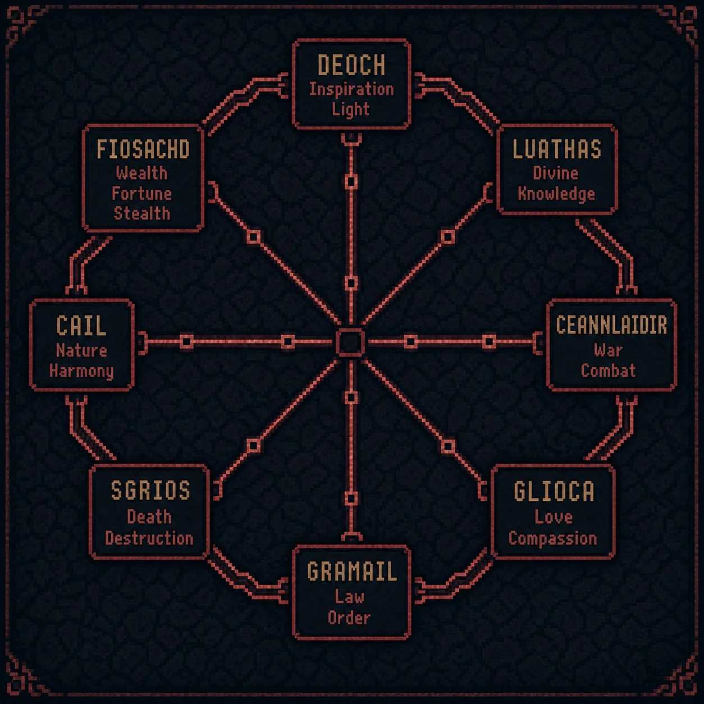
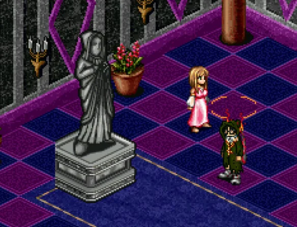
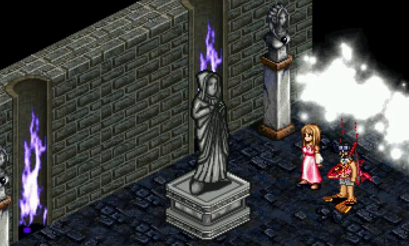
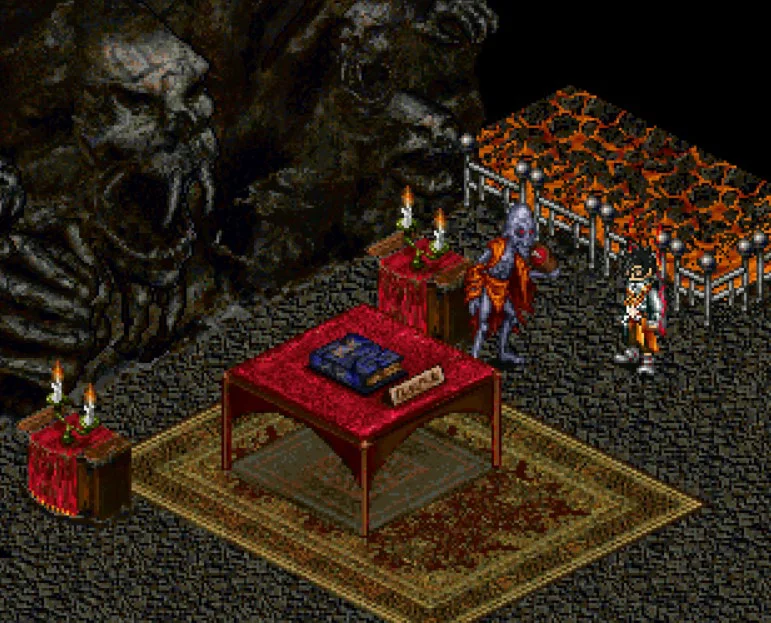
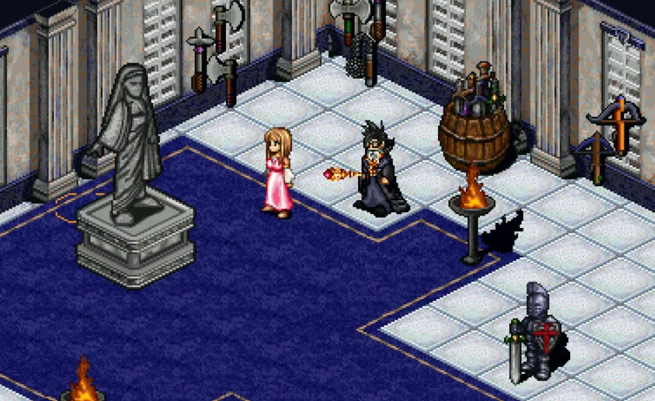

# The Completed Circuit: On the Opposing Gods of Temuair

_by KupoMog in **Dark Ages**_

The gods of Temuair have allies, enemies, and opposites. Allies are simple enough. Enemies are rarely shy. Opposites are where mystery begins.

The known faiths already give allies and enemies practical meaning. Deksar math-K'sull's glossary records each god's domain, allies, and enemies, and explains that an Aisling may attend the mass of a god within their Trinity and desecrate items belonging to an enemy faith (Deksar math-K'sull, n.d.). If an opposite were merely another enemy, there would be little reason to give it a different name. An enemy stands against a god in conflict. An opposite stands across from a god in meaning.

Harmony becomes easier to recognize when disruption is possible. Compassion matters because suffering exists. Knowledge shines brightest at the edge of the unknown. Even life gains urgency because it does not continue forever. This does not make every opposing force pleasant, good, or worthy of praise. Death may be necessary without murder becoming sacred. War may reveal courage without endless battle becoming wise. Opposition gives a power its boundary; it does not excuse every action committed in that power's name.

A simple Terran battery offers a useful comparison. Its two terminals are opposites, but they are not enemies. Neither is trying to conquer the other. Their difference creates potential, and when a path connects them, power can flow. A battery with only one terminal is not peaceful. It is useless. A magnet tells a similar story: two poles remain different, yet their difference belongs to one whole.

Perhaps the gods work in much the same way. Their opposing natures create tension. Temuair provides the path between them. Aislings, carrying Deoch's Spark of inspiration and the capacity to create or destroy, decide what shall be done with the power that follows (Deksar math-K'sull, n.d.).

The gods are not completed by agreement alone. Their opposing natures form the boundaries by which each divine purpose may be known. As a circuit requires difference before its power may flow, Temuair requires opposition before its harmony, struggle, wisdom, compassion, fortune, and mortality may possess meaning.



_Figure 1. The Divine Circuit._

## Listening to the Faithful

To better understand these relationships, I gathered opinions from practitioners of several faiths. I did not ask them to hand me one official answer. I wanted to see how each faith understood the space between a god and an opposite. Their responses helped shape this paper, and they also made one point very clear: the circuit does not carry only one kind of current.

Some described opposites as complementary forces. Others described them as different methods aimed toward a similar end. Another saw opposition through the cycle of growth and decay. None of them reduced the matter to a simple contest in which one god must win and the other must lose.



_Figure 2. Voices of the Faithful._

## Deoch and Gramail: Spark and Shape

Krivia of the Deoch faith described Deoch as the spark of life and imagination and Gramail as law, structure, and stability. In Krivia's view, the two are opposed but complementary. Without Gramail, Deoch's creations risk becoming formless. Without Deoch, Gramail's order risks becoming lifeless and stagnant (Krivia, Mail, Deoch 221 Spring).

This is the completed circuit in its clearest form: spark and shape. Inspiration begins the work, but boundaries allow the work to become something. A poem needs words. A painting needs an edge. Even the wildest idea needs some structure before another Aisling can see it, understand it, or build upon it. Gramail does not have to extinguish Deoch's flame. Gramail may be the lantern that lets the flame be carried.

Willa Lala Grey, Priest of Gramail, offered a related but more cautious view. She argued that the gods' positions in the Octave do not necessarily indicate a complete ideological inversion. Gramail is not simply static and unchanging, and Deoch is not true entropy. Both faiths may value art and happiness, but they differ in priorities and methods. Deochians may place greater trust in passion and immediate expression, while Gramailians temper passion with reason, judgment, and concern for lasting consequences (WillaLala, Mail, Deoch 221 Spring).

This distinction matters. If Deoch were nothing but chaos and Gramail nothing but stillness, their relationship would be easy to draw and not very interesting. Instead, they overlap. Both can value creation, but one asks, "What might be made?" while the other asks, "What will it become, and what will follow?" Their tension is less like two armies meeting on a field and more like a lively argument at a workbench.

Without Deoch, nothing new begins. Without Gramail, nothing new knows what it is.



_Figure 3. Deoch's Flame._

## Luathas and Sgrios: The Lesson and Its Ending

The glossary names Luathas as the god of divine knowledge, or Gnois, and Sgrios as the god of death, destruction, and chaos (Deksar math-K'sull, n.d.). At first, knowledge and death may not seem like the neatest pair. One fills the mind; the other empties the world. Yet a practitioner of Luathas offered a connection through life itself.

The Luathas priest who signed the message as Iglis described knowledge as a gradual building of the self through experience, ability, and observation. Sgrios, through death, sickness, rot, and decay, breaks structures down. In that view, everything needs an ending, including a cycle of learning. Death does not erase the meaning of the lesson; it turns the page and places that lesson within a larger cycle (Iglis, Mail, Deoch 221 Spring).

This pairing does not suggest that ignorance defeats knowledge. Sgrios does not prove Luathas wrong. Instead, Sgrios reminds the scholar that time is limited. No Aisling can read every scroll, ask every question, or master every mystery. That limit can make learning more precious. A book with no final page may continue forever, but it can never be completed.

The circuit here is not simply creation and destruction. It is accumulation and release. Luathas gathers, orders, and preserves understanding. Sgrios ensures that no single body, mind, or age can hold everything forever. Knowledge must therefore be taught, recorded, questioned, and passed onward. Mortality turns private learning into a shared responsibility.

The end of the learner need not be the end of the lesson.



_Figure 4. Chef Feeding a Friend._

## Cail and Ceannlaidir: Action and Reaction

Cail and Ceannlaidir are already joined by more than opposition. The glossary identifies Cail as the son of Glioca and Ceannlaidir and explains that Ceannlaidir refused his son weapons. Cail became the patron of Monks, but not an ally of his father. Cail represents nature and its harmony, while Ceannlaidir represents war and combat (Deksar math-K'sull, n.d.). Their connection is family, strength, disagreement, and consequence all at once.

Nadja Spellweave, High Priestess of Cail, described both gods as powerful forces capable of crushing their enemies through raw strength, but said they pursue their aims differently. Ceannlaidir seeks peace through conflict and subjugation. Cail represents nature, balance, defiance, and the reaction of a living thing pushed to the edge. Nadja summarized their opposition as action and reaction, or cause and effect (Nadja, Mail, Deoch 221).

This is not the gentle attraction of two magnets. It is the resistance within the circuit. Ceannlaidir acts; Cail answers. War attempts to impose an outcome, while nature pushes back, adapts, survives, and restores balance where it can. The two may desire something called peace, but they disagree sharply about what peace is and how it should be reached.

Their relationship also shows why an opposite is not automatically an enemy. Cail and Ceannlaidir are not listed as one another's enemies in the glossary. Their conflict lies in their methods and meanings rather than in a formal declaration of religious enmity. They stand across from each other like force and resistance: connected by the same event, but moving in different directions.

Ceannlaidir strikes the blow. Cail is the world that refuses to stay down.



_Figure 5. Preparing for Battle._

## The Aisling in the Middle

A circuit is not completed merely because two terminals exist. There must be a path between them. In this philosophy, that path is Temuair, and Aislings are not passive wire. They choose how the current moves.

Deksar's glossary describes an Aisling as one touched by Deoch's Spark, capable of wielding light and darkness, stopping evil or beginning it, and destroying or creating (Deksar math-K'sull, n.d.). That freedom is exactly why opposition matters. If only one path were possible, virtue would require no decision. Compassion would be automatic. Judgment would never be tested. Courage would have nothing to face.

Opposites give choices weight. Deoch and Gramail ask whether inspiration should run free or accept a shape. Luathas and Sgrios ask what we will learn before our time ends and what we will leave behind. Cail and Ceannlaidir ask whether peace is imposed through force or grown through balance and resistance. The gods provide the tension, but Aislings turn tension into consequence.

This may also explain why the same opposite looks different from different temples. A Deochian sees the danger of lifeless order. A Gramailian sees the danger of passion without judgment. A Cail worshipper sees resistance where a follower of Ceannlaidir might see disorder. The circuit is shared, but each faith stands at a different point along it.

## Does Necessity Excuse Harm?

There is an obvious danger in calling an opposing force necessary. If death, war, chaos, or suffering gives another principle meaning, does that make harmful acts acceptable? No. A boundary can be necessary without every crossing of that boundary being good.

Fire gives warmth, but it can still burn a village. Law can protect, but an unjust judgment remains unjust. War may reveal courage, but it also leaves wounds. Death gives life urgency, but that does not make the careless taking of life just. To recognize a force as part of the world is not to praise every use of it.

The completed circuit is therefore not a demand that every god be treated as morally equal. It is a claim that meaning often arises through relation. Each god reveals something about the limits, risks, and possibilities of another. The wise Aisling does not worship the wire. The wise Aisling asks what the current is powering.

## Conclusion: Let the Current Flow

The gods of Temuair are not completed by agreement alone. Some oppose one another through structure and inspiration. Some through growth and decay. Some through action and reaction. Their relationships are not identical, but each demonstrates why opposite and enemy should not be treated as the same word.

An enemy seeks defeat. An opposite may define, restrain, answer, challenge, or complete. It may show a god where its domain ends. It may reveal what happens when a virtue becomes excessive. It may give Aislings a real choice instead of a single road painted to look like freedom.

A battery with one terminal carries no useful current. A pantheon with only one principle would offer no meaningful balance. Temuair lives in the space between its divine powers, and Aislings live by deciding what to do there.

The circuit is completed not when one side wins, but when the distance between them becomes a path.

## References

Deksar math-K'sull. (n.d.). Glossary of terms in Temuair. Dark Ages.  
[https://www.darkages.com/2000/community/lore/Deksar_Glossary/glossary.html](https://www.darkages.com/2000/community/lore/Deksar_Glossary/glossary.html)

Special thanks for the practitioner interviews to:

- Krivia
- WillaLala
- Iglis
- Nadja

_KupoMog Philosophy Submission_

***

```
*Librarian Notes*

Recognized: Village, 2026 (Mileth College master list).
This entry has been heavily edited to conform to Library formatting.
The original can be found at https://novus-imperia.com/college/phi/kupomog_circuit.pdf .
```
