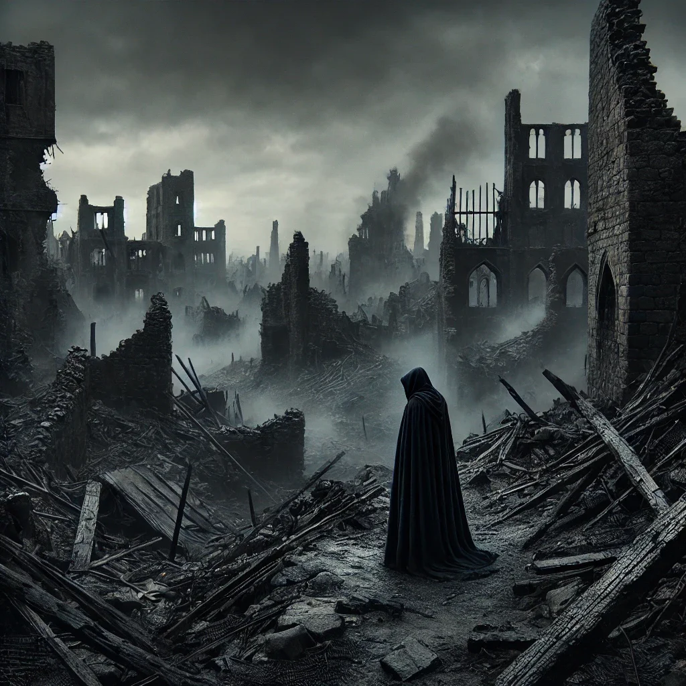

# The Broken Cycle: Echoes of another Lost Civilization

_by NotVorlof in **Dark Ages**_



As the sun sets on the crumbling remnants of Temuair, I find myself compelled to write. This account, The Broken Cycle: Echoes of Another Lost Civilization, is a record of the past few decades, chronicling the errors and decisions that have brought us to the brink of destruction. My hope is that these words might endure the fall of our world, standing as a testament to our mistakes.

Perhaps they will serve as a warning for those who come after.

## Stage 1. The Withering of Trust

### Corruption in Mileth

Once the heart of law and governance in Temuair, Mileth has grown rotten from within. Officials, sworn to protect, now revel in control, abusing their authority. Acts of brutality are no longer isolated incidents but a daily reality. Citizens are framed for crimes they did not commit, and whispered accusations carry the weight of execution orders. Those who once believed in justice find themselves hunted, leading many to retreat into isolation, no longer willing to risk the town's dangerous streets.

### Mundanes Turn Their Backs

The mundanes of Temuair were once guardians, listening with compassion and acting as divine protectors. But something has changed. Now, they answer Aisling prayers with cruelty or ignore them altogether. The most devout, who seek mercy or guidance, find only disdain and cold exile in return. Innocents vanish from the realm at the mundanes' whims, cast out for reasons as mysterious as they are cruel. In time, the once-populated cities have become abandoned relics, standing as silent witnesses to the mundanes' betrayal.

## Stage 2. Fractures Among the Aislings

### Factions Rise

With Mileth's protection gone, Temuair's people scatter. Those who crave power and dominance form the Orcs, a horde that takes by force, spreading fear and destruction wherever they tread. In contrast, a determined resistance known as Anti emerges; several splintered factions dedicated to pushing back against the Orcs' tyranny. Lastly there are also the hunters who choose not to fight, individuals who avoid the chaos of battle, striving only to exist quietly, living off the land and its creatures. They do not seek violence; they merely want to endure and preserve their way of life amid the conflict.

### Erosion of Unity

With each faction fighting its own battles, the ties that once bound the Aislings together are slowly eroding. The Orcs see the hunters as weak, while the forces of Anti view the Orcs as an unstoppable threat. The hunters, in turn, resent both factions for dragging a war they never wanted into the world they live in. Unity is no longer possible. Only suspicion, hatred, and fear remain.

## Stage 3. The Barrier of Change: The Crust Emerges

### Gatekeepers of Decay

Those few Aislings who dare to challenge the status quo meet with resistance unlike any other; The Crust. These grotesque beings, a fusion of ancient power and the decayed flesh of aislings long gone, appear from the shadows to crush any hope of reform. With a twisted cackle, they silence those who dare to speak for change. The Crust is not merely a force of destruction; it is the embodiment of Temuair's rot.

### Resistance is Futile

Knowing that The Crust can silence any voice, most Aislings lose hope in any meaningful change. Each attempted reform is torn apart, leaving the people trapped in a nightmare they can neither escape nor alter. The once-fervent cries for change fade to whispers, as Aislings begin to accept that they are truly powerless against the evil that holds Temuair captive.

## Stage 4. Descent into Lawlessness

### Society Unravels

With Mileth's rulers corrupted, the mundanes indifferent, and The Crust ever lurking, Temuair descends into chaos. Once-thriving cities are now battlegrounds, and the streets run with the blood of the innocent. Theft, betrayal, and violence replace trust and community, and survival becomes the only goal. Temuair's civilization has eroded into a lawless wasteland, with no refuge to be found.

### The Mundanes' Wrath Grows

The mundanes' punishments become harsher, with arrests and exiles meted out for the slightest offences, or sometimes, for no reason at all. To the Aislings, the mundanes become little more than tyrants, feared and no longer revered. Temples fall into ruin as worship fades; only the desperate or deluded still pray, hoping for mercy that will never come.

## Stage 5. Survival Amid the Ruins

### Total Breakdown

As the conflict between the Orcs and Anti continues to ravage Temuair, the hunters retreat to the fringes, seeking out a meager existence. Yet even in their isolation, they are not safe from the omnipresent chaos. The Crust's influence is felt everywhere, a silent spectre that thrives on the land's decay. For most, survival has become the only goal. And yet, even in the darkest hours, there are those who refuse to give up hope.

### New Ways of Survival

In this dark time, small groups begin to form, choosing secrecy over strength. Hidden in forests, mountains, or abandoned ruins, these clusters work together to weather each day. They scavenge, share their findings, and form close bonds built not on ideology but on the shared will to survive. In their isolation, they create new codes of trust, resilience, and patience, determined to find meaning in survival amid the chaos.

## Steps to Surviving the final days of Temuair

As Temuair teeters on the brink of total collapse, survival demands more than just resilience—it calls for caution, adaptation, and unity among the few who still hope. The chaos that envelops our world has stripped away the old ways of living, leaving only the bare essentials for those willing to endure.

The steps that follow are not guarantees but guideposts, hard-learned from countless losses and small victories alike. They are whispers from those who came before and from those who still remain, reminders that even in a broken world, survival is possible for those with the strength to persevere.

### Form Hidden Alliances

Trust is hard-earned. Only those who have proven themselves can be relied upon. Hidden alliances with other hunters or trustworthy members of Anti may be the key to survival, but secrecy is paramount.

### Limit Visibility

Survival demands caution. Avoid drawing attention to yourself, stay away from Mileth, and practice stealth in every movement. To evade the eyes of Mileth's patrols and the reach of the mundanes, even daily routines must be carefully hidden.

### Share Knowledge and Skills

In this broken world, self-sufficiency is vital. If you know how to forage, hunt, or heal, teach others in your alliance. Each skill shared strengthens the group, offering small but essential edges in a world hostile to the unprepared.

### Create Safe Havens

Establish sanctuaries far from the chaos; deep forests, forgotten ruins, or cavernous mountains. These hidden havens offer protection from both faction conflicts and the oppressive grip of Mileth. Make them defensible, secret, and always ready for rapid escape.

### Preserve Hope and Culture

Even in darkness, remember the identity of the Aislings. Share stories of better times, teach old songs, or paint symbols of resilience on walls. These remnants of the past strengthen the spirit and give courage to endure, becoming the seeds for a future beyond survival.

### Watch for Opportunities to Resist

Though dangerous, the occasional act of quiet rebellion can give purpose beyond mere survival. Whether it's rescuing an innocent from Mileth's grasp or sabotaging The Crust's influence, small acts of defiance can remind the people of Temuair that their spirit remains unbroken.

Even in this broken world, hope endures. It lives quietly in the hearts of those who remember what Temuair once was and who believe in what it could still become. Amid the ruins, where shadows linger and silence reigns, small acts of kindness, whispers of rebellion, and memories of our lost unity remind us that something worth saving remains. We cling to these fragments, nurturing them as seeds that may one day break through the darkness. For as long as even one Aisling remembers hope, Temuair's story is not yet over.

In the remnants of Temuair, survival alone becomes an act of quiet rebellion.

_Not Vorlof, Deoch 207_

***

```
*Librarian Notes*

Recognized: Clave (Mileth College master list).
This entry has been edited to conform to Library formatting.
The original can be found at https://novus-imperia.com/college/phi/notvorlof_broken.pdf .
```
